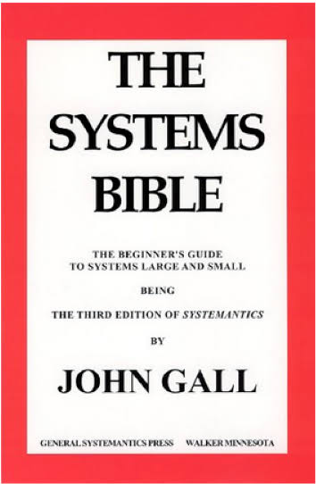

刚搬进新家的人，最容易犯的错，是急着把一切规划好：一口气买齐所有柜子、收纳盒和挂钩，把每个角落都安排得明明白白。可住上一个月就会发现，钥匙总堆在玄关，杯子总落在沙发边，最贵的那个柜子反而最没用。搬家前的所有规划，都只发生在脑内预演里。

这种错，半个世纪前就有人看透了。上世纪七十年代，美国密歇根州有个叫 John Gall 的儿科医生，一个四十多岁、天天和孩子的发烧与疫苗打交道的人。他在医院、政府机构和科研项目里见惯了各种雄心勃勃却跑不起来的系统，索性把大量系统失灵的案例收集成册，写成一本书——一本被三十家出版社拒稿、最后被图书馆归进“幽默”类的小书。书里有一条建议，后来被软件工程圈广泛使用。

这就是高尔定律（Gall's Law）：

> 一个能运转的复杂系统，无一例外，都是从能运转的简单系统演化而来的；而一个从零开始设计的复杂系统，从来就运转不起来，靠修修补补也救不回来——你只能从头再来，从一个能运转的简单系统做起。

*图：《The Systems Bible》书影，2002 年——《Systemantics》的第三版，当年那本被拒稿三十次的幽默小书，最后长成了大部头的“系统圣经”*

之所以如此，是因为需求不确定、环境开放、组件互相依赖的时候，我们不知道自己不知道什么。一个过早设计的系统，很可能在为一个根本不存在的需求精雕细琢；而它真正会遇到的问题，只有跑起来才会暴露。

## 便宜的构建，昂贵的判断

过去，高尔定律的约束一半来自“构建很贵”：写代码要时间、要人力，试错成本高，复杂系统天然不敢一次造完。现在，LLM 把构建成本压到近乎为零——一个下午，就能生成一个功能齐全的应用。于是诱惑也随之变大：既然造东西这么便宜，为什么不一步到位，直接把完整形态设计出来？

但软件工程里，写代码从来都是容易的那一半，难的是知道该构建什么。LLM 让“实现”变得便宜，却没有让“判断”变得便宜。它可以替你生成十个功能，却不能替你回答：这十个功能里，有几个对应着真实的需求？过去，为想象中的需求买单的是工程师的工时；现在，买单的是你自己的判断力和注意力。错误没有变便宜，只是更容易被批量生产了。LLM 消除的是“不知道怎么做”，消除不了“不知道该做什么”。

所以高尔定律在今天反而更锋利了：当构建不再是瓶颈，真实世界就成了唯一的瓶颈。

## 让复杂度长出来

那我们该怎么做？不妨把手头的事情分成三类，分别对待：

- 已经知道的风险和需求——比如事后很难改的基础决策，以及已经确认的真实需求——当然应该提前想清楚，这不叫过度设计。
- 知道自己不知道的——比如用户到底会不会用某个功能——用小实验去验证，别在会议室里争论。
- 那些不知道自己不知道的，没有任何办法提前处理，只能让系统尽早进入真实环境，让问题自己暴露出来。

LLM 在这个故事里的正确用法，是加速这个循环：更快地搭出最简单的闭环，更快地拿到真实反馈，更快地迭代。它应该缩短“简单系统长成复杂系统”所需要的时间。至于借它跳过这段演化、直达想象中的终局——高尔定律正是在那里等着你。
